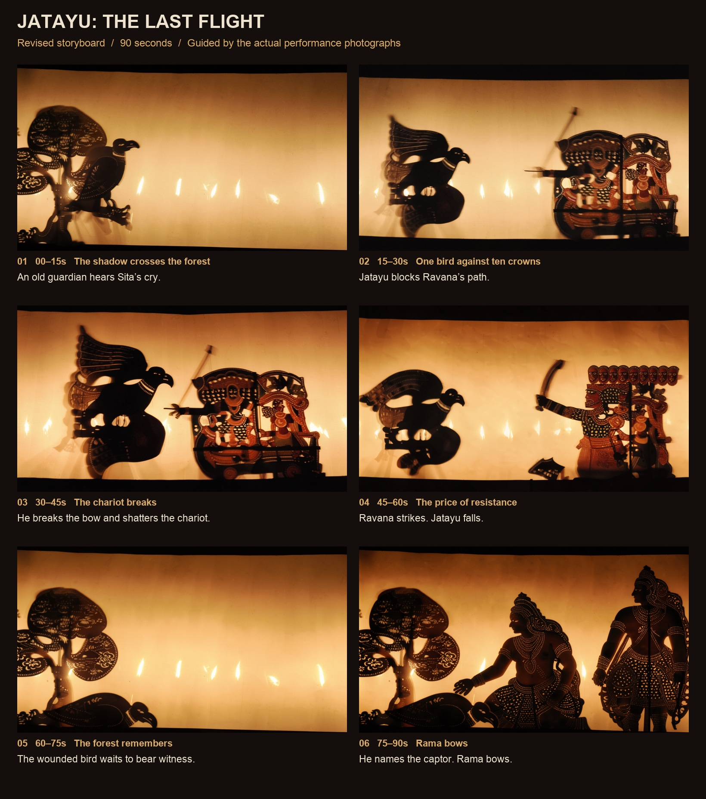
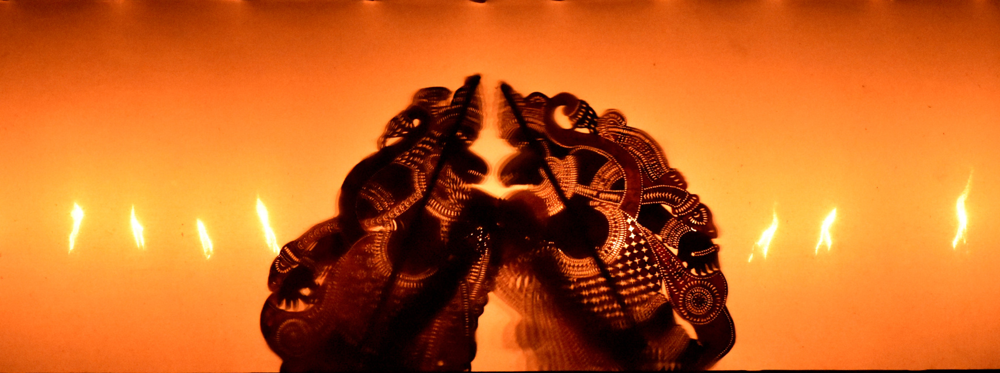
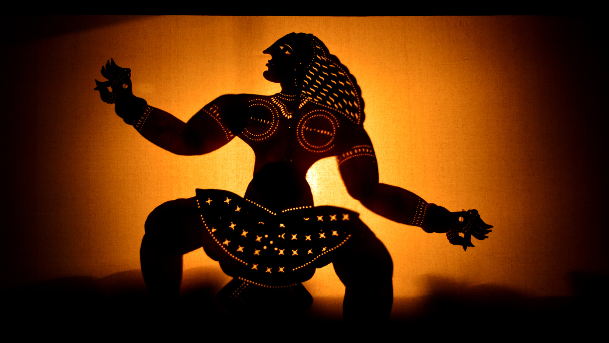
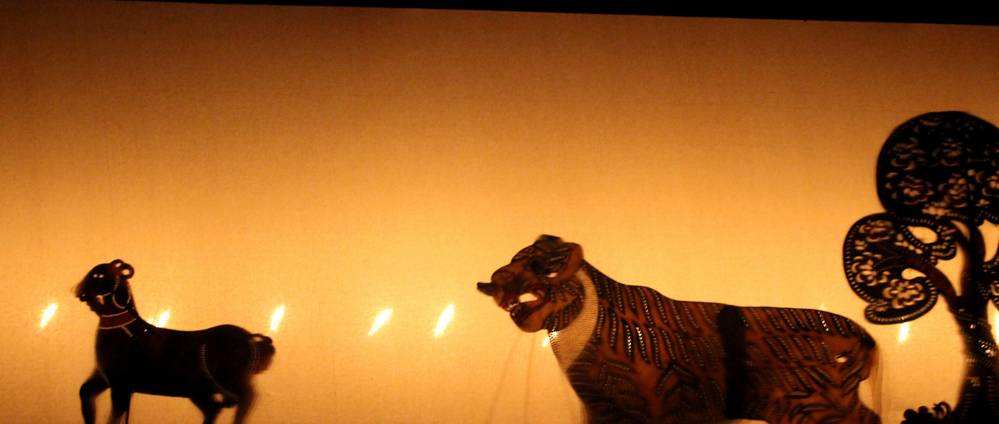
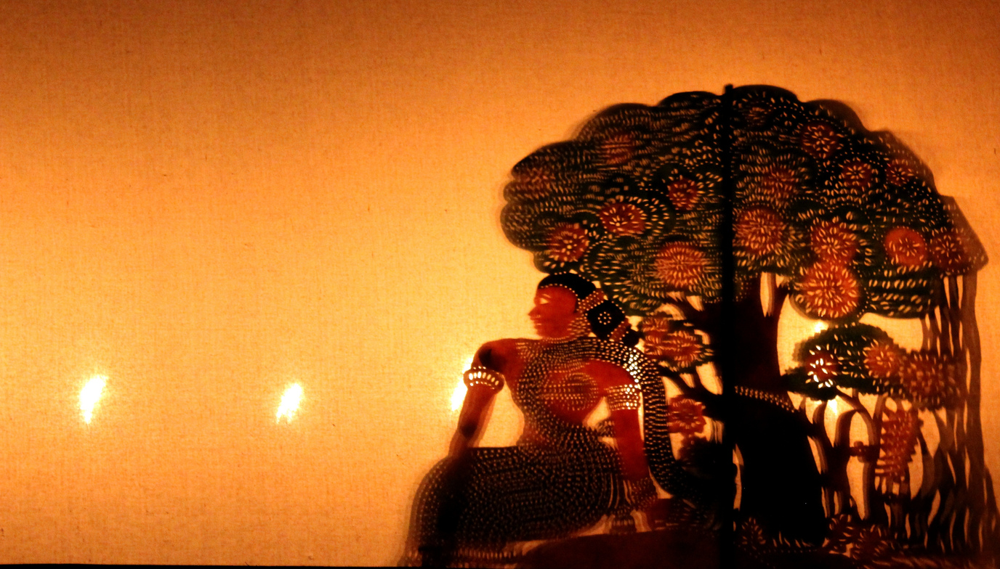
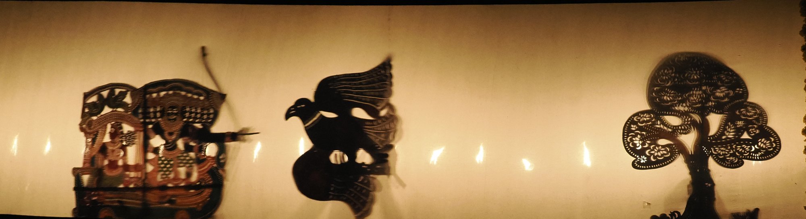
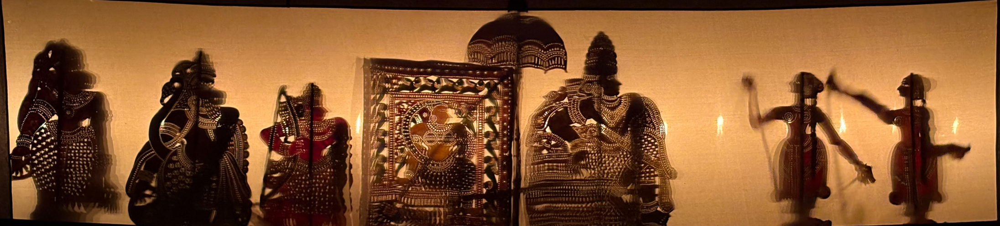

# Tholpavakoothu · shadow-puppet film LoRA

A rank-32 FLUX 3 Image Klein adapter trained on 20 credited audience-view photographs of Kerala leather shadow-puppet performances. **Checkpoint: 2000. Trigger: `thlpvk style`.**

**Hugging Face model:** [https://huggingface.co/Barath/tholpavakoothu-flux3-lora](https://huggingface.co/Barath/tholpavakoothu-flux3-lora)

## Submission

Style: Kerala Tholpavakoothu leather shadow-puppet performance: dark cutouts, perforations and warm cloth backlighting.  
Data: 20 credited Wikimedia Commons performance photographs (17 CC BY-SA 4.0, 3 CC BY 4.0), cropped and resized; individual sources and changes in CREDITS.txt.  
Checkpoint: Step 2000, rank/alpha 32/32 LoRA trained on FLUX 3 Image Klein Base; final images generated on distilled Klein.  

### Jatayu: The Last Flight — 90 seconds

A condensed Ramayana episode, rendered as leather shadow-puppet theatre. The finished film includes original synthesized Kerala-inspired music, designed sound effects, generated ambience and English story captions.

<video controls src="https://huggingface.co/Barath/tholpavakoothu-flux3-lora/resolve/main/films/jatayu/jatayu-the-last-flight.mp4" width="100%"></video>

[Watch/download film](https://huggingface.co/Barath/tholpavakoothu-flux3-lora/resolve/main/films/jatayu/jatayu-the-last-flight.mp4) · [Without subtitles](https://huggingface.co/Barath/tholpavakoothu-flux3-lora/resolve/main/films/jatayu/jatayu-the-last-flight-clean.mp4) · [SRT subtitles](films/jatayu/narration.srt) · [Storyboard](films/jatayu/storyboard.jpg) · [Credits](films/jatayu/FILM-CREDITS.txt)



### Additional film: Titanic — Shadows on the Sea

[90-second film](https://huggingface.co/Barath/tholpavakoothu-flux3-lora/resolve/main/films/titanic/titanic-shadows-on-the-sea.mp4) · [Without subtitles](https://huggingface.co/Barath/tholpavakoothu-flux3-lora/resolve/main/films/titanic/titanic-shadows-on-the-sea-clean.mp4) · [Storyboard](films/titanic/storyboard.jpg) · [Subtitles](films/titanic/narration.srt)

This second film uses the same trained adapter with an approved AI-generated design reference for simpler silhouettes, soft edges and visible lamp glows. The design preview is not claimed as a LoRA output. Its final six keyframes were generated with the trained LoRA on distilled Klein.

## Downloads

- [Download adapter weights](https://huggingface.co/Barath/tholpavakoothu-flux3-lora/resolve/main/pytorch_lora_weights.safetensors?download=true) — 160,701,024 bytes; SHA-256 `18b36db2cf084edffb210b65e4087412666a4404b81180956c8cfb524eccff9c`.
- [Full dataset: 20 images and captions](https://huggingface.co/Barath/tholpavakoothu-flux3-lora/resolve/main/tholpavakoothu-dataset.zip?download=true).
- [Source and transformation manifest](dataset-manifest.json) and [photographer credits/licences](CREDITS.txt).
- [Reproduction source on GitHub](https://github.com/Barath19/tholpavakoothu-flux3-film).

## Six training examples

These are prepared source photographs, not generated pictures. The original authors, licences and image modifications are recorded in [individual source records](training-examples/sources.json).

| 01 | 06 | 11 |
|---|---|---|
|  |  |  |
| 12 | 16 | 20 |
|  |  |  |

## Same-prompt, same-seed comparison

Both images below use distilled FLUX 3 Image Klein, 1360×768, 16 steps and seed **1711**. The unfused adapter weight is **0** in the baseline and **0.75** in the adapted result. All other settings and the complete expanded prompt are identical. Four paired cases and their hashes are in the [evaluation manifest](comparison/manifest.json).

| Without LoRA (weight 0) | With LoRA (weight 0.75) |
|---|---|
|  |  |

The underlying model already reproduces the general shadow-puppet idea. Across these four qualitative examples, the adapter shifts silhouettes, perforations and amber illumination. This is not a benchmark or a claim of cultural authenticity; anatomy, rods and object geometry can remain imperfect.

## Training and generation

- Training model: `black-forest-labs/flux-3-image-klein-base`, revision `3f7fa5ee22ca1d5a5cc095ac7cc96e6a173b4c86`.
- Image-generation model: `black-forest-labs/flux-3-image-klein`, revision `337337621b8526e120f2275d250242f4a6bedd75`.
- Diffusers: `b800f828f3951c4d206e154411bcbfa693cd322e`.
- Rank/alpha 32/32; bf16; batch 1; AdamW 8-bit; learning rate 1e-4; 2000 steps; 1024-area aspect-ratio buckets; no flips.
- Samples/checkpoints every 250 steps; checkpoint 2000 selected through visual review.
- Inference: 16 steps; LoRA 0.75 for Jatayu/comparisons and 0.65 for Titanic. The distilled guider ignores CFG.
- Video: six 15-second FLUX 3 Video clips per film, edited to 90 seconds at 720p/24fps with original synthesized score and captions.

## Loading the adapter

First obtain access to the upstream BFL model under its model terms. Use the pinned Diffusers version from the reproduction repository.

```python
pipe.load_lora_weights("Barath/tholpavakoothu-flux3-lora", adapter_name="thlpvk")
pipe.set_adapters("thlpvk", adapter_weights=0.75)
# End a content prompt with: thlpvk style
```

## Attribution and terms

The photographs remain under their individual CC BY 4.0 / CC BY-SA 4.0 licences. Credit Vishnu90s, Mullookkaaran, Suyash Dwivedi, Tonynirappathu and Shagil Muzhappilangad as detailed in CREDITS.txt. Some photographs were geometrically straightened; all preparation operations are recorded. No generated imagery was inserted into the training photographs.

The creator reports that a BFL mentor confirmed this dataset qualifies for the challenge. That does not change its attribution requirements. The adapter requires the upstream BFL model; consult [its model terms](https://huggingface.co/black-forest-labs/flux-3-image-klein-base). No blanket licence is asserted over third-party materials.

The music is an original synthesized interpretation, not a recording of a traditional troupe. Technical checks passed for both films; subjective audio audition was not performed by the assistant.

## Reproduce training and evaluation

Run on a CUDA machine with access to the gated upstream models:

```bash
cd training
bash bootstrap.sh
source .venv/bin/activate
python run_train.py --steps 2000 --max-minutes 180
python evaluate.py --checkpoint output/checkpoint-2000 --model distilled --revision 337337621b8526e120f2275d250242f4a6bedd75
```

Training time depends on the GPU. Resume saved training with `--resume` if the process time limit ends first. The process timeout does not stop a cloud machine. Credentials must stay outside the repository.

Film directories contain prompts, captions, storyboards, technical verification and original soundtrack/edit scripts. These scripts document the macOS/FFmpeg finishing workflow; adjust the system font paths on other operating systems. Downloaded source clips are not included; final films are linked above.
